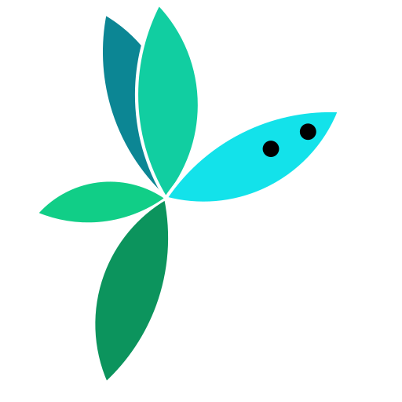

# ScarletNX
<p align="center">
  <br>
  <b>Wimsy, the ScarletNX mascot</b>
</p>

Discord: https://discord.gg/tRTRXXbyjp (my god why don't we just use IRC like good people?)

A GPLv3 static ARM64 to x86 recompiler with a Nintendo Switch translation layer for Linux, Windows and FreeBSD.

Forked from MZLab's SwitchRecomp. SwitchRecomp is based off Nexium.

The shared ARM64 recompiler lives under `src/common/`. Nintendo Switch Horizon HLE
and Maxwell graphics live under `src/nx/`. The CPU-only Linux AArch64 runtime lives
under `src/gnuabi/` and builds without the Switch graphics or media dependencies:

```sh
cmake -S . -B build/gnuabi -DSNX_BUILD_NX=OFF
cmake --build build/gnuabi
build/gnuabi/scarletnx-gnuabi ./test_aarch64
```

See [Linux ABI execution and QEMU validation](docs/GNUABI.md) for supported syscalls,
virtual filesystems, static ELF execution, and current limits. The NX executable also
has `scarletnx-erista`, `scarletnx-mariko`, and `scarletnx-aula` aliases.

The recompiler is also a library on its own, `libscarletnx-recompiler`: a program hands
it ARM64 or AArch32 code in memory and runs the result in its own process with its own
SVC handler, with no Switch runtime behind it. See
[The recompiler as a library](docs/LIBRARY.md).

Install the build tools first. On Debian/Ubuntu:
```bash
sudo apt update
sudo apt install build-essential git cmake ninja-build clang llvm-dev nasm pkg-config \
  libx11-dev libxext-dev libxrandr-dev libxcursor-dev libxi-dev libxfixes-dev libxss-dev libxtst-dev \
  libasound2-dev libpulse-dev libpipewire-0.3-dev
```
If your distribution provides `libsdl3-dev`, install it too. Otherwise CMake builds a pinned SDL3
using the X11 and audio development packages above. SDL2 is not a substitute for SDL3. You also
need a Vulkan 1.3 driver to run games. See [Build prerequisites](./docs/BUILD.md#prerequisites) for
Wayland, other systems, and the SDL3 troubleshooting steps.

Then build:
```bash
git clone --depth=1 https://github.com/scarletnx/ScarletNX
cd ScarletNX
cmake --preset default -B build && cmake --build build
```

For encrypted dumps, put `prod.keys` (and `title.keys`, for NSPs) in `~/.switch`, or pass them with
`--keys` and `--title-keys`. Decrypted DNSP/DXCI content needs no keys.
```bash
./build/scarletnx "Game.xci"  # extract, recompile, then play (also accepts NSP, DNSP and DXCI)
```
Run the same command again after an interruption. Completed extraction and recompilation are skipped,
but the game always starts anew. To run the steps separately:
```bash
./build/scarletnx -x "Game.xci" --name Game  # -> work/Game/{exefs,romfs}
./build/scarletnx -r work/Game Game         # -> games/Game/Game
./build/scarletnx -rx "Game.xci"            # prepare without playing (UNIX)
./build/scarletnx -Hs "Game.xci"            # headless, wait for GDB (UNIX)
cd games && ./Game
```

For an SDL3 menu, run `./build/scarletnx` with no arguments. Select a driver with arrow keys and
Enter or hover and click, then choose drag-and-drop or the paginated `games/` browser.
The GUI shows live driver/game
output and combined CPU/RAM usage. See [GUI launcher](docs/GUI.md).

The experimental `scarletnx-3ds` driver and **Load 3DS CIA** menu entry support
decrypted application CIA extraction (`scarletnx-3ds -x game.cia`) and an independent
page-based memory controller. An opt-in ARM11 integer profile and checked-memory
adapter now have static AOT witnesses, without changing shared A57 defaults.
**CIA-to-native execution, HLE and devices remain incomplete**; a normal CIA launch
extracts, then stops explicitly before execution.
See the [staged 3DS port](docs/3DS.md) for limits, build instructions and remaining work.

For more detailed information please see: [Build + run](./docs/BUILD.md). For the Android app (arm64 and x86_64),
see [Android](./docs/ANDROID.md).
For an error a game or the driver prints, see [Troubleshooting](./docs/TROUBLESHOOTING.md).

# Special thanks

- yuzu, Suyu, Torzu, Ryujinx, [Ryubing](https://git.ryujinx.app/ryubing/ryujinx) (Ryujinx's continuation), [Citron](https://git.citron-emu.org/citron/emulator) and [Eden](https://git.eden-emu.dev/eden-emu/eden).
- [Atmosphère](https://github.com/Atmosphere-NX/Atmosphere)
- LibHac.
- [Nexium](https://nexium-emu.org/) for research and development.
- [Switchbrew](https://switchbrew.org) for research.
- [Azahar](https://github.com/azahar-emu/azahar) and Citra, for all of the 3DS emulation.

Wimsy, the mascot and the runtime's icon (`dist/wimsy.svg`) was drawn by Liz.
